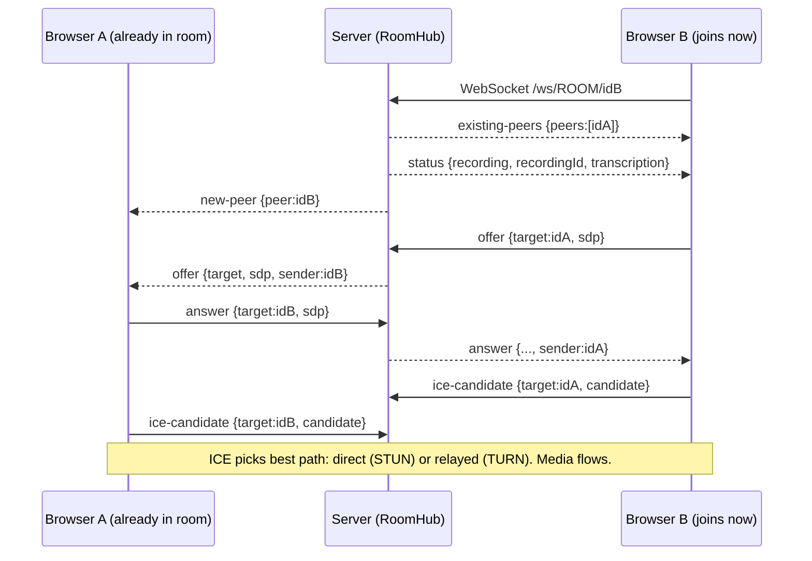

# WebrtcMeet — How It Works, How to Integrate It, and How to Explain It

A .NET 8 video-meeting app: browser-to-browser WebRTC calls, a WebSocket signaling server, server-side recording, offline Whisper transcription, and SQLite storage.

---

## 1. The big picture

```
 Browser A ◄────── WebRTC media (P2P, or via TURN relay) ──────► Browser B
    │  ▲                                                            │  ▲
    │  │ WebSocket /ws/{room}/{client}  (signaling only)            │  │
    ▼  │                                                            ▼  │
 ┌─────────────────────  ASP.NET Core server (Program.cs)  ─────────────────────┐
 │  RoomHub / Signaling  → relays offer, answer, ICE; room status flags          │
 │  REST API             → rooms, schedule, recordings, transcripts              │
 │  WhisperService       → WAV → text (whisper.cpp via Whisper.net)              │
 │  SQLite (data/meetings.db) + data/recordings + data/transcripts + data/models │
 └───────────────────────────────────────────────────────────────────────────────┘
```

**Key idea:** the server never touches audio/video during a call. It only *introduces* browsers to each other (signaling). Media flows directly between browsers (a *mesh*). If a direct path is blocked by NAT/firewall, a **TURN server** relays the media. That is the part you are replacing with coturn.

**Topology limit:** every participant sends video to every other participant, so it works well up to \~4–6 people. Beyond that you need an SFU (LiveKit, mediasoup, Janus).

---

## 2. How a call is set up (step by step)



Rules the code follows:

- **The newcomer is always the initiator.** It receives `existing-peers` and sends an `offer` to each one. Existing peers just wait (`new-peer` does nothing in `call.js`).
- ICE candidates that arrive before `setRemoteDescription` are queued in `pendingCandidates` and flushed afterwards.
- The server adds `sender` to every relayed message so the receiver knows who it came from.
- On `peer-left`, or when `connectionState` becomes `disconnected/failed/closed`, the tile and `RTCPeerConnection` are removed.

---

## 3. File-by-file explanation

### Backend

| File | What it does |
| --- | --- |
| `Program.cs` | Entry point. Loads `.env`, builds settings, registers services (DI singletons), starts Whisper loading in the background, serves `static/` with `no-cache`, and declares **all REST endpoints** plus the `/ws/...` WebSocket route. Default URL `http://0.0.0.0:8000`. Removes the request-size limit (recording chunks and audio clips). JSON property names are written exactly as declared. |
| `Config/AppSettings.cs` | `DotEnv.Load` reads `.env` (real environment variables win; empty values ignored). `AppPaths.ResolveRoot` finds the folder containing `static/`. `AppSettings` holds `DataDir`, `RecDir`, `TrDir`, `ModelDir`, `WhisperModel`, `WhisperLanguage`, `WhisperThreads`, `MaxPendingClips`, `RecordingStaleSeconds` and creates the data folders. |
| `Models/Models.cs` | `Json` options (non-ASCII such as Hindi/Marathi stays readable), `Ids.IsValid` (only `A-Z a-z 0-9 _ -`, 1–64 chars; protects against path traversal), and the DTOs `ScheduleRequest`, `Meeting`, `Segment`, `RoomFlags`. |
| `Services/Signaling.cs` | `Peer` wraps one WebSocket with a send queue (a socket must not be written concurrently). `RoomHub` keeps `room → client → Peer` and per-room flags (recording, recordingId, owner, transcription); methods `Join`, `Leave`, `Broadcast`, `SetRecording`, `SetTranscription`. `Signaling.HandleAsync` is the receive loop: handles switches (`set-recording`, `set-transcription`, `get-status`, `hello`) and relays everything else to `target`. Max message 1 MB. |
| `Services/Stores.cs` | `RecordingService` (create file, append chunks, finalize, find, list, recover stale), `TranscriptStore` (insert segment + export `.json`/`.txt`), `ScheduleStore` (CRUD for meetings), `RecordingRecoveryService` (background job every 10 s that finalizes recordings with no chunk for 30 s). |
| `Services/SqliteStore.cs` | Opens `data/meetings.db` in WAL mode, creates tables `meetings`, `recordings`, `transcripts` and indexes, provides `WithConnection`/`Execute` helpers. |
| `Services/WhisperService.cs` | Downloads the GGML model on first run into `data/models/`, builds a `WhisperProcessor`, exposes state `loading → ready` or `error` (auto-retry after 30 s), and `TranscribeWavAsync` (one inference at a time via a semaphore; drops markers like `[MUSIC]`). |
| `WebrtcMeet.csproj` | .NET 8 web project; packages `Whisper.net` + runtime 1.8.1 and `Microsoft.Data.Sqlite`; copies `static/` and `.env` to the output folder. |
| `.env` | Runtime settings (see section 7). |

### Frontend (`static/`)

| File | What it does |
| --- | --- |
| `index.html` + `home.js` | Home page. Start instant meeting (`GET /api/new-room`), join by code or pasted link, schedule/list/delete meetings. Saves your name in `localStorage` (`meet_name`). |
| `room.html` | The call page: pre-join screen, video grid, control bar (mic, cam, rec, CC, files, leave), caption bar, side panel for recordings/transcript. Loads `call.js` then `features.js`. |
| `call.js` | **The WebRTC core.** Reads `room`/`name` from the URL, gets camera+mic, opens the WebSocket, creates one `RTCPeerConnection` per peer, exchanges offer/answer/ICE, renders tiles, mic/cam toggles, leave, copy-invite-link. Holds **`ICE_SERVERS`**. Calls the hooks `window.onSignalingReady(ws)` and `window.beforeLeave()` provided by `features.js`. |
| `features.js` | Recording and captions. `CompositeRecorder` draws all `<video>` tiles onto a 1280×720 canvas, mixes all audio with the Web Audio API, records WebM with `MediaRecorder` in 2 s slices, and `PUT`s each slice to the server (5 retries). The transcriber records the local mic in 8 s clips, converts WebM/Opus → 16 kHz mono WAV in the browser, and `POST`s it to `/api/transcribe`. Also renders captions and the recordings list. It reads `ws`, `roomId`, `localStream` as globals from `call.js`. |
| `style.css` | Dark theme. |

---

## 4. REST API reference

All IDs (`room`, `recId`, `recordingId`) must match `^[A-Za-z0-9_-]{1,64}$`, otherwise `400 {"detail":"bad id"}`. Errors have the shape `{ "detail": "message" }` unless noted.

### Rooms and scheduling

| Endpoint | Input | Success output | Errors |
| --- | --- | --- | --- |
| `GET /api/new-room` | none | `{ "room": "a1b2c3d4" }` (8 chars) | — |
| `POST /api/schedule` | JSON `{ "title": "Sprint review", "time": "2026-10-05T15:30", "host_name": "Vedant" }` | `{ "id", "title", "time", "host_name", "created_at" }` | `422` if title or time missing |
| `GET /api/schedule` | none | `[ Meeting, ... ]` sorted by `time` | — |
| `DELETE /api/schedule/{meetingId}` | path | `{ "ok": true }` (even if id does not exist) | — |

### Recording

| Endpoint | Input | Success output | Errors |
| --- | --- | --- | --- |
| `POST /api/recordings` | query `room`, optional `ext` (`webm` default, or `mp4`) | `{ "id": "12charid" }`, creates an empty file `data/recordings/{room}__{id}.webm` | `400 bad id` / `bad ext`; `409 This meeting is already being recorded` |
| `PUT /api/recordings/{recId}/chunks` | raw binary body (one MediaRecorder slice) | `{ "bytes": 1234567 }` (total so far) | `404 recording not open` |
| `POST /api/recordings/{recId}/complete` | none | `{ "ok": true, "status": "ready" }` | `404 unknown recording` |
| `GET /api/rooms/{room}/recordings` | path | `[ { "id", "status": "recording"\|"ready", "size": bytes, "created": "2026-10-01T14:03:11", "url": "/api/recordings/{id}/download" } ]` newest first | — |
| `GET /api/recordings/{recId}/download` | path | the video file (`video/webm`, range requests supported), named `meeting-{room}-{id}.webm` | `404 recording is still active` |

A recording whose chunks stop for `RECORDING_STALE_SECONDS` is auto-marked `ready`, so a browser crash still leaves a playable file.

### Transcription

| Endpoint | Input | Success output | Errors / skips |
| --- | --- | --- | --- |
| `GET /api/whisper-status` | none | `{ "state": "loading"\|"ready"\|"error", "error": "", "model": "small" }` | — |
| `POST /api/transcribe` | query `room`, `name` (speaker, max 40 chars, default `Guest`), `start` (unix seconds, optional), `recordingId` (optional). Header `Content-Type: audio/wav`. Body: **16 kHz mono 16-bit PCM WAV** | `{ "name": "Vedant", "text": "hello everyone", "time": 1790000000.5 }` and the same segment is broadcast over WebSocket as `{type:"transcript", segment}` | HTTP 200 with `{ "skipped": "model loading" \| "busy" \| "empty" \| "no speech" }`; `502 { "error": "..." }` on Whisper failure; `400` bad id |
| `GET /api/rooms/{room}/transcript` | optional `format=text`, `download=1` | default: `[ { "name", "text", "time" } ]`. With `format=text`: plain text, one line per segment `[HH:mm:ss] Name: text`. With `download=1`: sent as `transcript-{room}.txt` | — |

`busy` happens when more than `MAX_PENDING_CLIPS` clips are queued; extra clips are dropped on purpose.

---

## 5. WebSocket protocol — `ws(s)://host/ws/{roomId}/{clientId}`

`clientId` is a UUID made by the browser (`crypto.randomUUID()`). All messages are JSON text frames, max 1 MB. Use `wss://` when the page is served over HTTPS.

### Client → server

| `type` | Fields | Effect |
| --- | --- | --- |
| `hello` | `name` | Ignored by server (can be used as a ping). |
| `get-status` | — | Server replies with `status`. |
| `set-transcription` | `active: bool` | Sets room caption flag, broadcasts `status`. |
| `set-recording` | `active: bool`, `recordingId: string` | `true` only works if no recording is active and `recordingId` exists in the DB; the sender becomes the recording owner. `false` clears it. Broadcasts `status`. |
| `offer` | `target`, `sdp` | Relayed to `target` with `sender` added. |
| `answer` | `target`, `sdp` | Same relay. |
| `ice-candidate` | `target`, `candidate` | Same relay. |

### Server → client

| `type` | Fields | When |
| --- | --- | --- |
| `existing-peers` | `peers: string[]` | Right after joining. |
| `status` | `recording`, `recordingId`, `transcription` | On join, on any change, on `get-status`. |
| `new-peer` | `peer` | Someone else joined. |
| `peer-left` | `peer` | Someone left or disconnected. |
| `transcript` | `segment: {name, text, time}` | After each transcribed clip. |
| `offer` / `answer` / `ice-candidate` | original fields + `sender` | Relayed from another peer. |

If the recording owner disconnects, the server finalizes that recording automatically.

---

## 6. Replace the static Metered TURN with your own coturn on AWS

### What is wrong today

`call.js` hard-codes one STUN entry and four TURN entries pointing at `global.relay.metered.ca` with a fixed username and credential that belong to **someone else's Metered account**. Problems: it can be revoked or rate-limited any time, you do not control it, and anyone who opens DevTools can copy the credentials. **Treat those credentials as burned and remove them from the code and from version control.**

### Step 1 — Launch the server

- EC2 Ubuntu 22.04/24.04,  (TURN is bandwidth-heavy, not CPU-heavy; watch the data-transfer cost).
- Attach an **Elastic IP** and (recommended) a DNS name such as `turn.yourdomain.com`.
- **Security group inbound rules:**

| Port | Protocol | Purpose |
| --- | --- | --- |
| 3478 | UDP + TCP | STUN/TURN |
| 5349 | TCP (+UDP) | TURN over TLS (`turns:`), passes strict firewalls |
| 49152–65535 | UDP | Relay ports (media) |
| 22 | TCP | SSH, your IP only |

### Step 2 — Install and configure

```bash
sudo apt update && sudo apt install -y coturn
sudo sed -i 's/#TURNSERVER_ENABLED=1/TURNSERVER_ENABLED=1/' /etc/default/coturn
openssl rand -hex 32        # → use this as the shared secret
```

`/etc/turnserver.conf`:

```ini
listening-port=3478
tls-listening-port=5349
listening-ip=0.0.0.0
# AWS instances sit behind NAT: tell coturn its public/private IPs
external-ip=<ELASTIC_IP>/<PRIVATE_IP>
realm=turn.yourdomain.com
fingerprint

# Time-limited credentials generated by your .NET server (no user database)
use-auth-secret
static-auth-secret=<THE_LONG_RANDOM_SECRET>

min-port=49152
max-port=65535
no-cli
no-multicast-peers
# Block relaying into private/internal ranges (important on AWS: stops access to metadata/VPC)
denied-peer-ip=10.0.0.0-10.255.255.255
denied-peer-ip=172.16.0.0-172.31.255.255
denied-peer-ip=192.168.0.0-192.168.255.255
denied-peer-ip=169.254.0.0-169.254.255.255

# TLS (Let's Encrypt, optional but recommended)
cert=/etc/letsencrypt/live/turn.yourdomain.com/fullchain.pem
pkey=/etc/letsencrypt/live/turn.yourdomain.com/privkey.pem
```

```bash
sudo systemctl enable --now coturn && sudo systemctl status coturn
```

### Step 3 — Generate credentials on the server (don't ship a static password)

coturn's `use-auth-secret` mode expects `username = <expiry-unix-time>[:label]` and `credential = base64(HMAC-SHA1(secret, username))`. Add this to `Program.cs` (before `app.Run()`), and add `TURN_HOST` and `TURN_SECRET` to `.env`:

```csharp
// GET /api/ice-config  ->  { iceServers: [...] }
app.MapGet("/api/ice-config", () =>
{
    var host   = Environment.GetEnvironmentVariable("TURN_HOST");    // turn.yourdomain.com
    var secret = Environment.GetEnvironmentVariable("TURN_SECRET");
    if (string.IsNullOrEmpty(host) || string.IsNullOrEmpty(secret))
        return Results.Json(new { iceServers = new object[] { new { urls = "stun:stun.l.google.com:19302" } } });

    var expiry   = DateTimeOffset.UtcNow.AddHours(4).ToUnixTimeSeconds();
    var username = $"{expiry}:meet";
    using var hmac = new System.Security.Cryptography.HMACSHA1(System.Text.Encoding.UTF8.GetBytes(secret));
    var credential = Convert.ToBase64String(hmac.ComputeHash(System.Text.Encoding.UTF8.GetBytes(username)));

    return Results.Json(new
    {
        iceServers = new object[]
        {
            new { urls = $"stun:{host}:3478" },
            new { urls = new[] {
                $"turn:{host}:3478?transport=udp",
                $"turn:{host}:3478?transport=tcp",
                $"turns:{host}:5349?transport=tcp" }, username, credential }
        }
    });
});
```

### Step 4 — Change `call.js`

Delete the whole static `ICE_SERVERS` block and load it from the server. In `joinCall()` fetch it before connecting:

```js
let ICE_SERVERS = [{ urls: 'stun:stun.l.google.com:19302' }];   // fallback only

async function loadIceServers() {
  try {
    const r = await fetch('/api/ice-config');
    ICE_SERVERS = (await r.json()).iceServers;
  } catch (e) { console.warn('Using fallback STUN only', e); }
}

// inside joinCall(), after getUserMedia succeeds and before connectSignaling():
await loadIceServers();
```

`createPeerConnection` already uses `new RTCPeerConnection({ iceServers: ICE_SERVERS })`, so nothing else changes.

> I wrote this snippet from the coturn REST-credential spec but have not compiled or run it against your server. Test it as below before relying on it.

### Step 5 — Test

1. Open `https://webrtc.github.io/samples/src/content/peerconnection/trickle-ice/`, enter your `turn:` URL plus a username/credential from `/api/ice-config`, click *Gather candidates*. You must see candidates of type **`relay`**. No relay candidates means ports, `external-ip`, or the secret is wrong.
2. Join a call from two networks (laptop on Wi-Fi, phone on mobile data). In `chrome://webrtc-internals`, the selected candidate pair should show `relay` when a direct path is impossible.
3. Server logs: `sudo journalctl -u coturn -f`.

---

## 7. Connecting this to an existing setup

**Run it as-is:** `dotnet restore && dotnet run -c Release`, open `http://localhost:8000`. Camera/mic need **HTTPS** on any non-localhost address, so put it behind a TLS reverse proxy:

```nginx
location / {
  proxy_pass http://127.0.0.1:8000;
  proxy_http_version 1.1;
  proxy_set_header Upgrade $http_upgrade;       # required for WebSocket signaling
  proxy_set_header Connection "upgrade";
  proxy_set_header Host $host;
  proxy_read_timeout 3600s;
  client_max_body_size 0;                       # recording chunks
}
```

Three ways to integrate:

1. **Link or iframe (easiest, no code changes).** Your existing app creates a room code and sends users to `https://meet.yourdomain.com/room.html?room=<code>&name=<display name>`. For an iframe add `allow="camera; microphone; display-capture"`. Use `GET /api/new-room`, or generate your own ID (letters, digits, `_`, `-`, up to 64 chars; it becomes the room automatically).
2. **Merge into your ASP.NET Core app.** Copy `Config/`, `Models/`, `Services/` and `static/`. In your `Program.cs` register the same singletons (`AppSettings`, `SqliteStore`, `WhisperService`, `RecordingService`, `TranscriptStore`, `ScheduleStore`, `RoomHub`, `RecordingRecoveryService`), call `app.UseWebSockets()`, and copy the `MapGet/MapPost/...` endpoints and the `/ws/{roomId}/{clientId}` route. Add the Whisper.net and Microsoft.Data.Sqlite packages.
3. **Use only the signaling protocol** with your own frontend (React/Angular/mobile web). Implement the WebSocket messages from section 5 and the flow from section 2; the REST endpoints are optional.

### `.env` settings

| Key | Meaning | Default |
| --- | --- | --- |
| `PORT`, `HOST` | listen port and address | `8000`, `0.0.0.0` |
| `DATA_DIR` | where DB, recordings, transcripts, models live | `./data` |
| `WHISPER_MODEL` | `tiny`, `base`, `small`, `medium`, `large-v3`, or a path to a `.bin` | `small` |
| `WHISPER_LANGUAGE` | `en`, `hi`, `mr`... empty = auto-detect | none |
| `WHISPER_CPU_THREADS` | CPU threads for Whisper | `0` (auto) |
| `MAX_PENDING_CLIPS` | clips queued before returning `busy` | `4` |
| `RECORDING_STALE_SECONDS` | auto-finalize delay used by the download endpoint | `30` |
| `TURN_HOST`, `TURN_SECRET` | *new*, for coturn (section 6) | — |

---

## 8. Known gaps to be honest about (and fix before production)

1. **Secrets in the zip.** The Metered credentials in `call.js` and a commented token line in `.env` (looks like a tunnel/ngrok auth token). Rotate/revoke the token and keep `.env` out of git.
2. **No authentication.** Anyone who knows a room code can join, list recordings, download them, and read transcripts. Add auth, or at least unguessable room IDs, before real use.
3. **Remote participants are labelled "Participant"** in `call.js`; the name sent in `hello` is ignored by the server, so names are not shown on tiles.
4. **Rooms live in memory.** One server instance only; a restart drops room state (SQLite data survives). Scaling out needs sticky sessions plus a shared hub.
5. `RecordingRecoveryService` hard-codes 30 s and ignores `RECORDING_STALE_SECONDS` (only the download endpoint honours it).
6. `.env` contains stale comments from an earlier Python version (`python main.py`, cpu/cuda, ffmpeg). `README.md` says the project was never compiled in the session that produced it, so run a full build and a two-browser test first.
7. Mesh topology: quality drops past \~6 participants.

---

### 9. in short explanation 


"It's a Google-Meet-style app. A small .NET server only *introduces* browsers to each other over a WebSocket; after that, video and audio go straight browser-to-browser with WebRTC. The server also stores recordings and uses Whisper to turn speech into text."

### Analogies that land

- **Signaling server = a switchboard operator.** It passes notes ("here's how to reach me") but never listens to the call.
- **STUN = "what's my public address?"** A mirror that tells a browser how it looks from the internet.
- **TURN = a post office.** When two browsers can't reach each other directly, both send to the post office, which forwards. Slower and costs bandwidth, but always works. That is coturn.
- **SDP offer/answer = exchanging business cards** (codecs, capabilities). **ICE candidates = the list of addresses you might be reachable at.**


